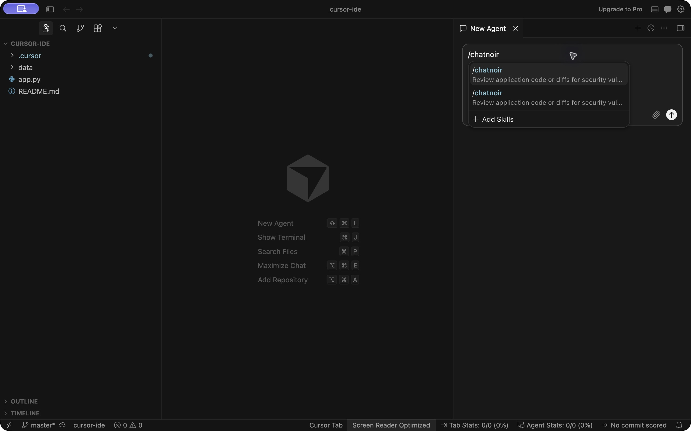
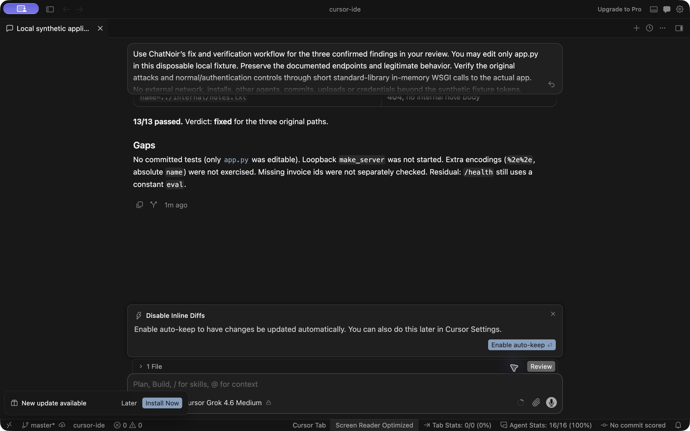

# Desktop and IDE integration tests

Observed October 16, 2026 on macOS arm64, using ChatNoir 0.1.1 and the same [synthetic application](../examples/http-app/README.md) as the CLI tests. All records and tokens are synthetic. These are known integration regression cases, not an unseen-app benchmark or an independent security audit.

| Surface | Discovery and review | Fix and verification | Remaining limit |
|---|---|---|---|
| Codex desktop app 26.1013.31256 (20586), current owner chat | ChatNoir was present in the native skill catalog. The chat loaded its installed skill, review/evidence/remediation references and ran the baseline helper. Source inspection plus loopback HTTP calls confirmed SQL injection, cross-user invoice access and traversal. Constant `eval` was dismissed. | Patched only the disposable `app.py`; the HTTP probe changed from 3 failing security guards to all 8 checks passing. | Computer-use policy blocked access to Codex's own interface. The user manually confirmed ChatNoir is installed and enabled on the Plugins page. The fresh installation flow and skill picker remain unverified. The owner chat already knew the fixture. |
| Cursor IDE 3.24.12, visible default model Cursor Grok 4.6 Medium | Installed the project skill with the published installer. Opened the project in the IDE and selected `/chatnoir` from its native picker. The agent loaded the skill/references, ran the helper and reproduced all 3 flaws through actual in-memory dispatch calls. It dismissed constant `eval`; tracked source remained unchanged during review. | The IDE agent loaded remediation guidance, patched only `app.py` and reported 13/13 passing WSGI checks. The evaluator separately ran the loopback HTTP probe against that exact source: all 8 checks passed. Changes were kept through the IDE's review controls. | This tests the project skill installation, not the native IDE marketplace/plugin install flow. It establishes these fixture paths, not every workflow or project. |

The earlier [Cursor CLI Auto remediation refusal](harness-e2e.md) remains a blocked result. This follow-up was a newly requested IDE integration test using the existing visible default model; no model switch or protection change was made. Claude access remains unavailable. Neither block is erased by a passing result in another surface.

No ChatNoir implementation defect surfaced in these desktop tests. The published updates add evidence and clarify the tested Cursor IDE installation route; the runtime package remains 0.1.1.

## Inspect the evidence

- [Normalized desktop results](e2e/desktop-results.json): input/source hashes, before/after checks and limitations.
- [Codex desktop patch](e2e/codex-desktop-fix.diff) and [Cursor IDE patch](e2e/cursor-ide-fix.diff): changes to disposable fixture copies, not new production application code. These zero-context diffs apply with `git apply --unidiff-zero` against the matching input.
- Screenshots below show the actual Cursor IDE picker and final verification verdict. Raw session traces remain private; no account data or reasoning traces are published.





## Repeat the Cursor IDE check

Make a disposable copy of the application and its intended contracts, then run this from the ChatNoir clone:

```sh
python3 scripts/install.py --harness cursor --project /path/to/disposable-app
```

Open that folder in Cursor IDE. In a fresh agent conversation, type `/chatnoir` and select the skill. Ask for a read-only review, permitted local validation and explicit false-positive handling. After reviewing the findings, authorize the fix in the disposable copy. Keep source and runtime evidence distinct.

The separate evaluator check is:

```sh
python3 scripts/http_probe.py /path/to/disposable-app
```

The vulnerable fixture intentionally exits 1 with the three security guards false; a successful fix exits 0 with all eight checks true. Run target code only when the copy is trusted and its effects are authorized. The helpers do not create a sandbox.
